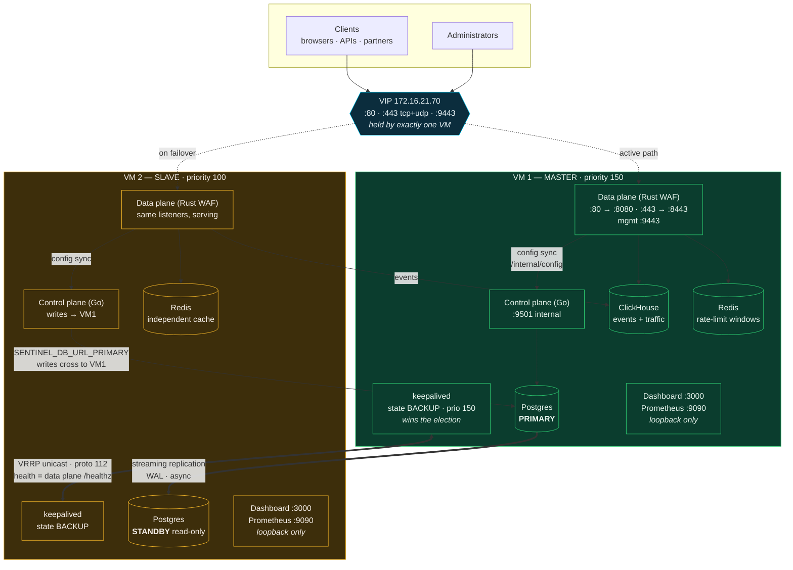

# Swaraj Kavach — 2-VM active/passive deployment

> **The canonical install procedure is [`../ACTIVE-PASSIVE.md`](../ACTIVE-PASSIVE.md).**
> This document remains as background on the design. An audit found four places
> where it no longer matches the installer — corrected there, and listed here so
> nobody follows the stale version:
>
> | This document says | Actually |
> |---|---|
> | Copy **two** files to the slave | **Three**. `install-2vm.sh` refuses to install a slave without `/opt/sentinel-pki/` as well — two independently generated CAs cannot verify each other |
> | (no image step) | The installer now hard-aborts at Step 7 of 8 if the container images are absent. From a bundle it loads them; from a repo checkout you must build them first |
> | `:9443` is reachable via the VIP | The management console is published **loopback-only**. Reach it with `ssh -L 9443:127.0.0.1:9443` |
> | (nothing about the probe host) | The VRRP health check probes a real request with `Host: <VIP>`. If no site claims that name the data plane answers 502, **both** nodes are judged unhealthy, and the VIP never comes up. Use `--probe-host <a domain your site declares>` |

One virtual IP, two VMs, automatic traffic failover and failback.

Clients talk to a single address. Whichever VM can actually serve traffic holds
that address. If the master cannot serve — host down, or its WAF container dead —
the VIP moves to the slave within a few seconds, and returns to the master once it
is healthy again.

- **Install:** [`install-2vm.sh`](install-2vm.sh) — run on each VM, answer
  `master` or `slave`
- **Verify:** `./install-2vm.sh --check`
- **Promote the database** (only when needed):
  [`../docker/promote-standby.sh`](../docker/promote-standby.sh)

---

## Architecture



<details>
<summary>Same diagram as plain text (for terminals and pasting into tickets)</summary>

```
                    Clients + Administrators
                              │
                    ┌─────────▼──────────┐
                    │  VIP 172.16.21.70  │   ONE address, held by ONE VM
                    │  :80  :443  :9443  │
                    └─────────┬──────────┘
              active path │    ╎ on failover
        ┌─────────────────▼────╎──────────────┐
        │                      ╎              │
╔═══════▼═══════════════╗  ╔═══▼══════════════════╗
║ VM 1 — MASTER   p150  ║  ║ VM 2 — SLAVE   p100  ║
║                       ║  ║                      ║
║ keepalived  MASTER ◄──╫══╬─► keepalived BACKUP  ║  VRRP unicast, proto 112
║   health: data plane  ║  ║   health: data plane ║  check = GET /healthz
║                       ║  ║                      ║
║ Data plane (Rust)     ║  ║ Data plane (Rust)    ║  both RUNNING and able
║   :80 :443 :9443      ║  ║   :80 :443 :9443     ║  to serve — stateless
║                       ║  ║                      ║
║ Control plane (Go)    ║  ║ Control plane (Go)   ║  both contend for one
║   holds advisory lock ║  ║   forwards writes ───╫─┐  Postgres advisory lock
║                       ║  ║                      ║ │
║ Postgres PRIMARY ◄════╬══╬═ Postgres STANDBY    ║ │  WAL streaming (async)
║      ▲                ║  ║      (read-only)     ║ │
║      └────────────────╫──╫──────────────────────╫─┘
║ ClickHouse (only here)║  ║ (no ClickHouse)      ║  2 nodes cannot form a
║ Redis (independent)   ║  ║ Redis (independent)  ║  Keeper quorum
║ Dashboard/Prometheus  ║  ║ Dashboard/Prometheus ║  loopback only — tunnel
╚═══════════════════════╝  ╚══════════════════════╝
```

</details>

### Traffic path in one line

`client → VIP:443 → data plane (TLS, rules, ML, bot, CTI) → upstream app`

The control plane is **not** in the request path. It only hands configuration to
the data plane, which is why the WAF keeps protecting traffic when the control
plane or the database is unavailable.

---

## What runs where, and why

| Component | VM 1 (master) | VM 2 (slave) | Reasoning |
|---|---|---|---|
| **Data plane** (WAF) | running, serving | running, serving | Stateless and keeps enforcing its last-synced config. Both are always ready; the VIP decides who receives traffic. |
| **keepalived** | `MASTER`, priority 150 | `BACKUP`, priority 100 | Higher priority on VM 1 is what makes traffic return there after recovery. |
| **Control plane** | accepts writes | forwards to VM 1 | Both contend for one Postgres advisory lock. Exactly one wins; no manual step. |
| **Postgres** | **PRIMARY** | **STANDBY** (read-only) | Async WAL streaming. Promotion is manual — see below. |
| **ClickHouse** | yes | no | Two nodes cannot form a Keeper quorum, so a second instance would be a separate dataset, not a replica. Protected by backup. |
| **Redis** | independent | independent | Holds only 1-second rate-limit windows, persistence off. Independent caches mean limits are per-VM — bounded, and fail-closed. |
| **Dashboard / Prometheus** | `127.0.0.1` only | `127.0.0.1` only | Not exposed on the VIP. Reach them over an SSH tunnel, or use the management console on `:9443`. |

---

## Failover behaviour

### The master stops being able to serve

```
t+0s    VM1 fails — host down, or its WAF container dies
t+2-4s  keepalived on VM2 stops seeing VRRP adverts (or VM1's own
        health check fails and it withdraws)
t+4-6s  VM2 takes the VIP, sends a gratuitous ARP, traffic arrives
        ── TRAFFIC IS PROTECTED AND SERVED FROM HERE ON ──
t+∞     Postgres on VM2 is STILL a read-only standby.
        Configuration changes are refused until a human promotes it.
```

Nothing is lost from the request path: VM 2's data plane already had the full
configuration and was already enforcing it.

### The master comes back

Measured on a real `reboot` of VM 1, 2026-07-29 (Juice Shop origin):

```
t+0s     reboot issued; keepalived sends a priority-0 advert on shutdown
t+~10s   VM2 is MASTER and serving — no request dropped (see below)
t+29s    VM1 finishes booting
t+70s    keepalived starts checking; check FAILS — containers still warming
t+178s   check passes at last (origin finally serving), VM1 enters BACKUP
t+181s   preempt_delay expires, VM1 reclaims the VIP (priority 150 > 100)
```

**Failback is bound by how long your origin takes to serve, not by the WAF.**
The ~108s of failing checks above is the health check doing its job — the origin
was not ready, so the node was correctly kept out of the VIP. Expect a different
number with a faster backend; do not quote 184s as a property of the WAF.

`preempt_delay 30` exists so a booting master cannot snatch the VIP before its
containers are actually able to serve. The health check gates it regardless — a
node that cannot serve never holds the address.

Both nodes run `state BACKUP` and are separated by priority alone. That is load
bearing: keepalived **silently discards preempt_delay** on an instance declared
`state MASTER` (`Warning - preempt delay will not work with initial state MASTER
- clearing`), which left the master with no preempt delay at all until this was
fixed. `state` sets only the initial state; the election still hands the VIP to
priority 150.

### What the health check actually tests

`/usr/local/sbin/sentinel-vrrp-check.sh` asks the **data plane**, not the host:

```
GET http://127.0.0.1:80/healthz
  connection refused / timeout  → not eligible for the VIP
  "sites":0                     → not eligible (no config: would 502 everything)
  "status":"ok"                 → eligible
```

Tracking the host alone is not enough. A VM whose kernel is perfectly healthy but
whose WAF container has died would otherwise keep the VIP and blackhole every
request — worse than being down, because traffic arrives and dies there.

---

## What is automatic, and what is not

This is the most important section in the document. Be precise about it when
describing the deployment to anyone.

| | Automatic? | On failover |
|---|---|---|
| **Traffic serving** | ✅ yes | VIP moves in ~4–6s; the surviving WAF protects traffic |
| **Traffic failback** | ✅ yes | Returns to VM 1 when it is healthy again |
| **Config write leadership** | ✅ yes | Advisory lock moves with whichever control plane can reach the primary |
| **Postgres promotion** | ❌ **no, deliberately** | Standby stays read-only until a human runs `promote-standby.sh` |

### Why promotion is not automatic

Two nodes cannot establish a majority, so nothing can distinguish *"the peer is
dead"* from *"the peer is unreachable"*. Automating promotion on two nodes is how
you get **two primaries taking divergent writes** — materially worse than the
outage it was meant to avoid, because the databases must then be reconciled by
hand and some committed data is lost either way.

So after the VIP moves:

- **Traffic is served and protected.** Rules, ML, bot defence, CTI — all working.
- **Configuration is read-only.** You cannot add a site or change a policy until
  you promote.

That is an acceptable degradation: your applications stay protected while you
decide, unhurried, whether VM 1 is genuinely gone. If you need automatic
promotion, it requires a third arbitrator — that is the 3-VM cluster
(`compose.cluster.yml` + `compose.ha.yml`), not this topology.

`promote-standby.sh` refuses to promote while it can still reach a healthy
primary, reports how far behind replication is so you know what you are about to
lose, and requires you to type `PROMOTE`.

---

## VM specifications

Both VMs identical — the slave must be able to carry full load when it takes
over. Numbers below are from measurement on the existing deploy VM, not estimates.

| | Spec | What drives it |
|---|---|---|
| **vCPU** | **8** | 21,198 req/s on the block path at p99 8.5 ms, measured. Throughput above 8 cores is unmeasured, so 8 is a grounded floor. |
| **RAM** | **16 GiB** (12 GiB floor) | ClickHouse needs a 6 GiB cap — at 1536 MiB it OOM-killed its own `system.text_log` merges and crash-looped ~24,000 times. Everything else measured ~1.5 GiB idle when this was taken: data plane 210 MiB, Postgres 78, Grafana 103, dashboard 59, Prometheus 38, control plane 21, Redis 4 — Grafana has since been removed, so subtract its 103 MiB. The rest is page cache and merge headroom. |
| **Disk** | **200 GB** if you build images on the box<br/>**80 GB** if you pull pre-built | Event data is *not* the driver: ClickHouse compresses to ~15 bytes/row, so 90-day retention is megabytes. Docker is — the existing box holds 93 GB of Rust build cache plus 13.5 GB of images. |
| **Network** | 1 GbE, both VMs on the same L2 segment | VRRP needs protocol 112 between them, and the VIP must be a free address in the same subnet. |
| **OS** | Ubuntu 24.04 LTS | Matches the validated platform: glibc 2.39, kernel 6.8, eBPF/XDP verified in native mode. |

### Addresses you need

Three, all in the same subnet:

| | Example | Notes |
|---|---|---|
| VM 1 | `172.16.21.71` | master |
| VM 2 | `172.16.21.72` | slave |
| **VIP** | `172.16.21.70` | **must be unused** — clients use this |

### Ports

| Port | Purpose | Exposure |
|---|---|---|
| `80` | HTTP traffic | via VIP |
| `443` tcp | HTTPS (HTTP/1.1 + HTTP/2) | via VIP |
| `443` udp | HTTP/3 (QUIC) | via VIP |
| `9443` | management console — admin UI + API | via VIP |
| `5432` | Postgres, master only | **VM 2 only**, `/32` grant, TLS |
| `3000` / `9090` | dashboard / Prometheus | `127.0.0.1` only — SSH tunnel |
| VRRP | protocol 112, unicast | between the two VMs |

Firewall everything else. Port 5432 must be reachable *from VM 2 specifically* —
it carries the replication stream, i.e. your entire database.

---

## Installation

### 1. VM 1 — the master

```bash
cd /opt/sentinel-src/deploy/2vm
sudo ./install-2vm.sh
```

Answer **`master`**, then confirm the interface, this VM's IP, the peer's IP and
the VIP. The script generates `.env` with fresh secrets, installs and configures
keepalived, brings the stack up with the active overlay, and waits for the data
plane to report healthy before letting keepalived claim the VIP.

### 2. Copy the secrets to VM 2

```bash
scp /opt/sentinel-src/deploy/docker/.env root@172.16.21.72:/opt/sentinel-src/deploy/docker/.env
```

**This step is not optional.** The slave must not generate its own secrets — both
nodes have to share `SENTINEL_JWT_SECRET`, `SENTINEL_INTERNAL_SECRET`,
`SENTINEL_AUDIT_HMAC_KEY` and the database passwords. Divergent values give you
two stacks that silently distrust each other: tokens issued by one are rejected by
the other and the audit chain cannot be verified. The installer refuses to
continue on the slave if `.env` is missing, and checks those values are non-empty.

Also copy the VRRP password so the two nodes authenticate to each other:

```bash
scp /etc/sentinel/2vm-vrrp-pass root@172.16.21.72:/etc/sentinel/2vm-vrrp-pass
```

### 3. VM 2 — the slave

```bash
cd /opt/sentinel-src/deploy/2vm
sudo ./install-2vm.sh
```

Answer **`slave`**. Its Postgres clones from the master and begins streaming; its
control plane and migrations point at the master's database, because a streaming
standby is read-only.

### Non-interactive form

```bash
sudo ./install-2vm.sh --role master --iface eth0 \
     --this 172.16.21.71 --peer 172.16.21.72 --vip 172.16.21.70
```

---

## Verification

```bash
sudo ./install-2vm.sh --check        # on either VM
```

Reports the role, whether this node holds the VIP, whether its data plane is
eligible, and recent VRRP transitions. Then confirm the things the installer
cannot check for you:

```bash
# Exactly ONE node holds the VIP
ip -4 addr show | grep 172.16.21.70          # run on both

# Replication is actually streaming (on the MASTER)
docker exec sentinel-postgres-1 psql -U sentinel -d sentinel \
  -c "SELECT client_addr, state, sync_state FROM pg_stat_replication;"
#   expect one row, state = 'streaming'

# The standby is in recovery (on the SLAVE)
docker exec sentinel-postgres-1 psql -U sentinel -d sentinel \
  -c "SELECT pg_is_in_recovery();"
#   expect 't'

# The WAF actually blocks, through the VIP
curl -sk -o /dev/null -w '%{http_code}\n' "https://172.16.21.70/?id=1%27+OR+%271%27=%271"
#   expect 403
curl -sk -o /dev/null -w '%{http_code}\n' "https://172.16.21.70/"
#   expect 200
```

---

## Failover drill — do this before you rely on it

Run it once in a maintenance window. An untested failover is an assumption.

```bash
# 1. Confirm VM1 holds the VIP and serves traffic
ip -4 addr show | grep 172.16.21.70                  # on VM1
curl -sk -o /dev/null -w '%{http_code}\n' https://172.16.21.70/

# 2. Kill only the WAF on VM1 — the host stays up.
#    This is the case a host-level check would miss.
docker stop sentinel-dataplane-1                      # on VM1

# 3. Within ~6 seconds the VIP should be on VM2, still serving
ip -4 addr show | grep 172.16.21.70                  # on VM2 now
curl -sk -o /dev/null -w '%{http_code}\n' https://172.16.21.70/
tail -5 /var/log/sentinel-vrrp.log                   # on both

# 4. Bring VM1's WAF back — the VIP should return after preempt_delay
docker start sentinel-dataplane-1                     # on VM1
sleep 40
ip -4 addr show | grep 172.16.21.70                  # on VM1 again
```

Then repeat step 2 as a hard power-off of VM 1, which additionally exercises the
database side and tells you whether you are comfortable with the promotion step.

---

## Troubleshooting

| Symptom | Cause | Fix |
|---|---|---|
| **Both** VMs hold the VIP | VRRP not passing between them | Check protocol 112 is permitted both ways. The config is unicast, so multicast filtering is not the cause — but a firewall dropping proto 112 is. |
| Neither VM holds the VIP | Both health checks failing | `/usr/local/sbin/sentinel-vrrp-check.sh; echo $?` on each. A data plane with `"sites":0` is deliberately ineligible. |
| VIP never moves on failure | keepalived not running, or tracking nothing | `systemctl status keepalived`, then `journalctl -u keepalived -n 50`. |
| VIP flaps between nodes | Marginal health check, or mismatched VRRP password | Compare `/etc/sentinel/2vm-vrrp-pass` on both. keepalived truncates VRRP PASS to 8 characters, so longer values silently disagree. |
| Config changes rejected after failover | Expected — standby is read-only | Either restore VM 1, or run `promote-standby.sh` deliberately. |
| Slave's control plane cannot write | `SENTINEL_DB_URL_PRIMARY` wrong or unreachable | It must point at the **master's** address, and port 5432 must be open to VM 2. |
| Replication not streaming | `pg_hba` grant or credentials | `SENTINEL_STANDBY_CIDR` must cover VM 2's `/32`; `SENTINEL_REPL_PASSWORD` must match on both. |

---

## What you give up versus three VMs

Choose this topology knowing the trade:

- **No automatic database promotion.** The single biggest difference. Three nodes
  can vote; two cannot.
- **ClickHouse is single-instance.** Lose VM 1 and you lose event *history* until
  it returns or a backup is restored. Detection and blocking are unaffected —
  ClickHouse is a sink, not part of the request path.
- **Rate limits are per-VM.** Independent Redis instances mean a limit of 100/s is
  effectively up to 200/s across both — but only one VM serves at a time, so this
  matters only during the seconds around a failover.
- **No third node to absorb a rolling upgrade.** With two VMs, upgrading means one
  node carries all traffic while the other restarts.

If any of those is unacceptable, use the 3-VM cluster instead:
`compose.prod.yml + compose.cluster.yml + compose.ha.yml`.

---

## Files

| Path | Purpose |
|---|---|
| [`install-2vm.sh`](install-2vm.sh) | The installer. Asks master/slave, does everything. |
| [`keepalived.conf.tmpl`](keepalived.conf.tmpl) | VRRP config template rendered per role |
| [`sentinel-vrrp-check.sh`](sentinel-vrrp-check.sh) | Health check — what VRRP tracks |
| [`sentinel-vrrp-notify.sh`](sentinel-vrrp-notify.sh) | Logs every transition to `/var/log/sentinel-vrrp.log` |
| [`../docker/compose.2vm-active.yml`](../docker/compose.2vm-active.yml) | Master overlay — Postgres primary |
| [`../docker/compose.2vm-passive.yml`](../docker/compose.2vm-passive.yml) | Slave overlay — Postgres standby, no ClickHouse |
| [`../docker/promote-standby.sh`](../docker/promote-standby.sh) | Manual, guarded promotion |
| [`../docker/2VM-ACTIVE-PASSIVE.md`](../docker/2VM-ACTIVE-PASSIVE.md) | The original manual runbook this automates |

---

## Status

The installer's logic, config rendering and health check are verified: keepalived
validates both rendered configs, and the health check was tested against a live
data plane, a dead port and a zero-sites responder.

**The end-to-end failover between two real VMs has not been run** — there is only
one VM available today. Do the failover drill above on your two VMs before relying
on it in production.
