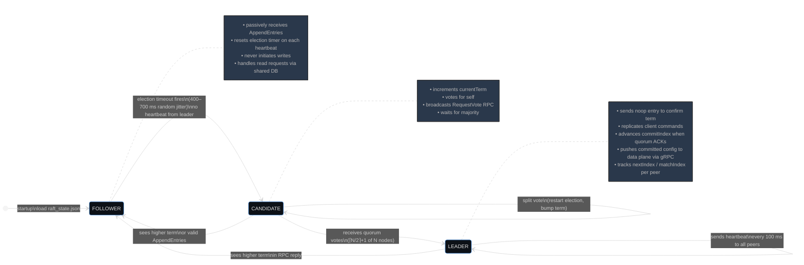
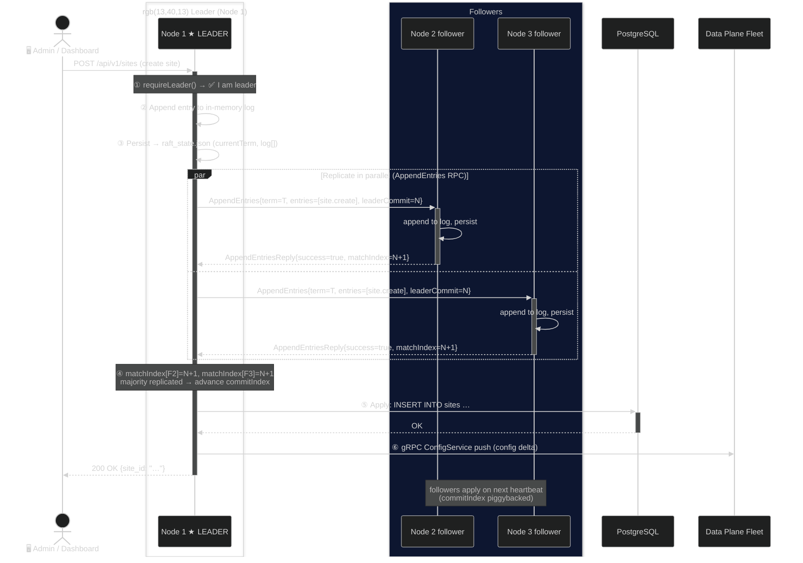
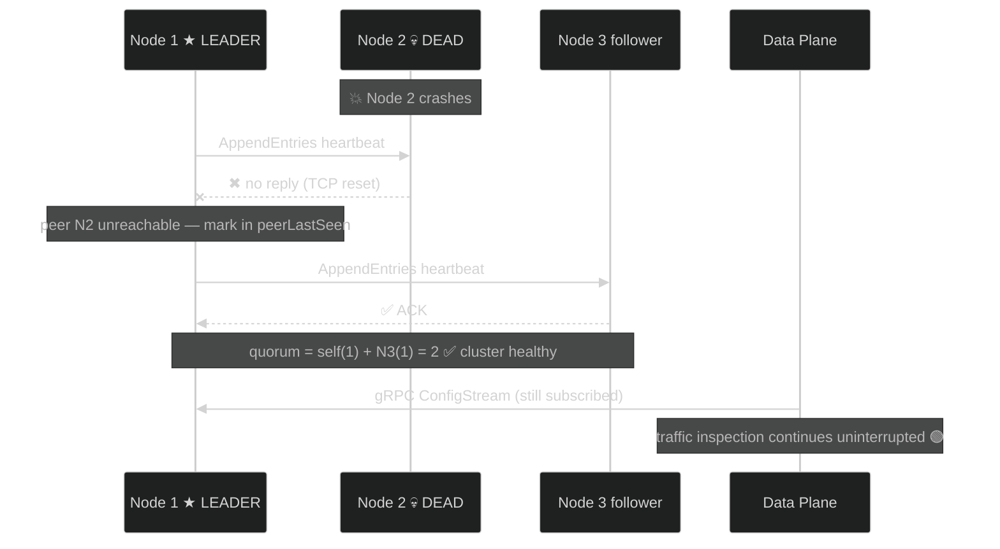
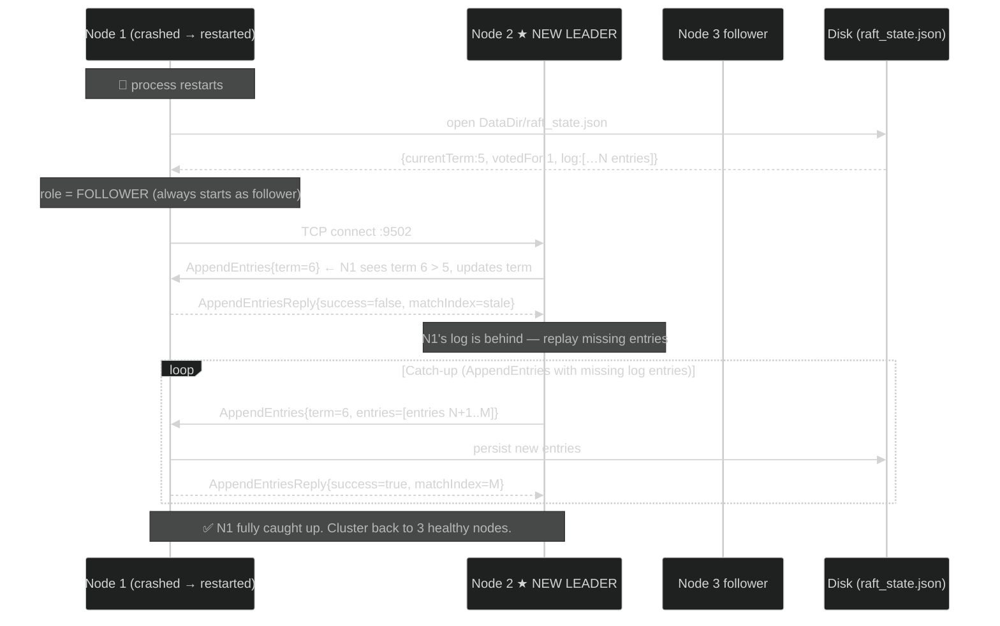
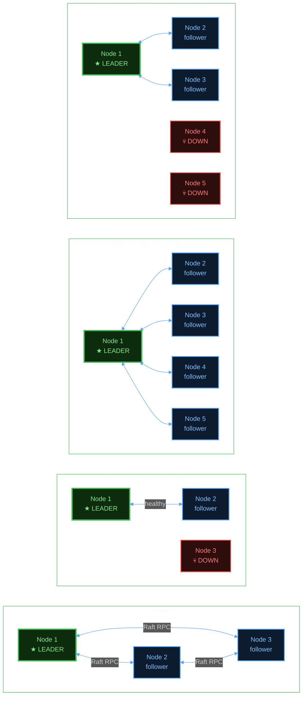
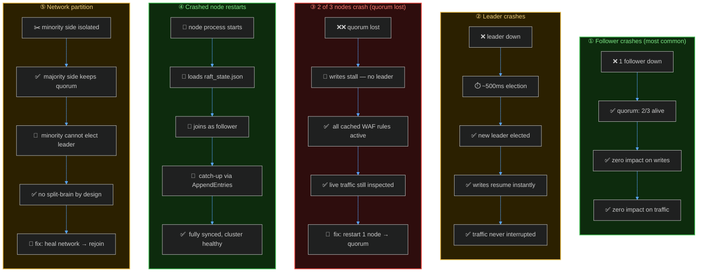

```mermaid
%%{init: {"theme": "dark", "themeVariables": {"primaryColor": "#0d1117", "lineColor": "#58a6ff", "fontFamily": "monospace"}}}%%
sequenceDiagram
    actor Admin as 🖥️ Admin
    participant N1 as Node 1  💀 CRASHED
    participant N2 as Node 2  follower → LEADER
    participant N3 as Node 3  follower
    participant DP as Data Plane Fleet

    Note over N1: 💥 CRASH  (disk, OOM, network — any reason)

    rect rgb(60,20,20)
        Note over N2,N3: ⏱️ 400–700 ms  —  No heartbeat detected
    end

    Note over N2: election timeout → become CANDIDATE
    N2->>N2: currentTerm: 5 → 6,  votedFor = self
    N2->>N3: RequestVote{term=6, candidateId=2, lastLogIndex=N, lastLogTerm=5}
    N3-->>N2: RequestVoteReply{voteGranted=true, term=6}

    Note over N2: votes = self + N3 = 2 ≥ quorum  →  🟢 LEADER
    N2->>N3: AppendEntries{term=6, entries=[noop]}  ← confirm leadership
    N3-->>N2: ACK  — steps down to follower

    Note over N2,N3: ✅  Cluster healthy.  Failover complete < 1 s

    DP->>N2: gRPC ConfigStream reconnect (detects leader change via heartbeat miss)
    Note over DP: zero traffic drop — data plane buffers config during gap 🟢

    Admin->>N1: POST /api/v1/rules  (still pointing at old IP)
    N1--xAdmin: ❌  Connection refused

    Admin->>N2: POST /api/v1/rules  (follow X-Sentinel-Leader header)
    N2->>N3: AppendEntries{entries=[rule.create]}
    N3-->>N2: ACK  (quorum met)
    N2-->>Admin: 200 OK
```

# Sentinel WAF — Raft Cluster Architecture

---

## 1 · Full System Topology

```
╔══════════════════════════════════════════════════════════════════════════════════╗
║                             🌐  INTERNET TRAFFIC                                ║
╚══════════════════════════════╤═════════════════════════════════════════════════╝
                               │  HTTP / HTTPS
                    ╔══════════▼═══════════╗
                    ║    LOAD BALANCER /   ║
                    ║    ANYCAST  (L4/L7)  ║
                    ╚══════╤═══════╤═══════╝
                           │       │
          ┌────────────────┘       └────────────────┐
          │                                         │
  ╔═══════▼════════╗                       ╔════════▼═══════╗
  ║  DATA PLANE #1 ║                       ║  DATA PLANE #2 ║  ← Rust, stateless
  ║  Rust  :8080   ║                       ║  Rust  :8080   ║    Inspect & proxy
  ║                ║                       ║                ║    every HTTP req
  ║ • Rule engine  ║                       ║ • Rule engine  ║
  ║ • ML scorer    ║                       ║ • ML scorer    ║
  ║ • Rate limiter ║                       ║ • Rate limiter ║
  ║ • TLS term.    ║                       ║ • TLS term.    ║
  ╚═══════╤════════╝                       ╚════════╤═══════╝
          │  gRPC stream                            │  gRPC stream
          │  (config push only,                     │  (config push only,
          │   subscribe to leader)                  │   subscribe to leader)
          └──────────────────┬──────────────────────┘
                             │
   ╔═════════════════════════╪══════════════════════════════════════════╗
   ║          CONTROL PLANE  │  (Go)  —  RAFT CLUSTER                  ║
   ║                         │                                          ║
   ║  ┌──────────────────────▼───────────────────────────────────┐     ║
   ║  │                                                           │     ║
   ║  │   ┌──────────────┐   Raft RPC   ┌──────────────┐         │     ║
   ║  │   │   NODE 1     │◄────────────►│   NODE 2     │         │     ║
   ║  │   │  ★ LEADER ★  │   TCP JSON   │  follower    │         │     ║
   ║  │   │  :9501 REST  │              │  :9601 REST  │         │     ║
   ║  │   │  :9502 Raft  │              │  :9602 Raft  │         │     ║
   ║  │   └──────┬───────┘              └──────┬───────┘         │     ║
   ║  │          │  Raft RPC                    │  Raft RPC       │     ║
   ║  │          │  TCP JSON                    │  TCP JSON       │     ║
   ║  │          └──────────┬───────────────────┘                 │     ║
   ║  │                     │                                     │     ║
   ║  │              ┌──────▼───────┐                             │     ║
   ║  │              │   NODE 3     │                             │     ║
   ║  │              │  follower    │                             │     ║
   ║  │              │  :9701 REST  │                             │     ║
   ║  │              │  :9702 Raft  │                             │     ║
   ║  │              └──────────────┘                             │     ║
   ║  └───────────────────────────────────────────────────────────┘     ║
   ║                         │                                          ║
   ║              ╔══════════▼══════════╗                               ║
   ║              ║   PostgreSQL (shared)║  ← all 3 nodes connect       ║
   ║              ║   applied log → SQL  ║    leader applies first      ║
   ║              ╚═════════════════════╝                               ║
   ╚══════════════════════════════════════════════════════════════════╝

  ╔═════════════════╗   REST API    ╔═════════════════╗
  ║  Dashboard (UI) ║──────────────►║  sentinelctl     ║
  ╚══════════╤══════╝               ╚═════════╤═══════╝
             │                               │
             └──────────────┬────────────────┘
                            │  POST /api/v1/*  →  hits leader only
                            │  non-leader → 503 + X-Sentinel-Leader header

  ════════════════════════════════════════════════════════
  KEY RULE:  Traffic inspection is ALWAYS on.
             Raft cluster being down ≠ WAF being down.
             Data plane never touches Raft directly.
  ════════════════════════════════════════════════════════
```

---

## 2 · Raft Node Internal State Machine



---

## 3 · Write Path — Config Change Replication (Normal Operation)



---

## 4 · SCENARIO A — Follower Node Crashes  (Zero Impact)

```
   BEFORE                                    AFTER CRASH
   ──────                                    ───────────

   ┌──────────┐    Raft RPC    ┌──────────┐    ┌──────────┐         ┌──────────┐
   │  NODE 1  │◄──────────────►│  NODE 2  │    │  NODE 1  │◄──────X │  NODE 2  │
   │ ★ LEADER │               │ follower │    │ ★ LEADER │  dead  │  💀 DOWN  │
   └────┬─────┘               └──────────┘    └────┬─────┘         └──────────┘
        │       Raft RPC                           │
        └──────────────────────────────────────────┘
              ▲                   ▲                    ▲
         ┌────┴────┐         ┌────┴────┐          ┌────┴────┐
         │  NODE 3 │         │  NODE 3 │          │  NODE 3 │
         │follower │         │follower │          │follower │ ← still ACKs
         └─────────┘         └─────────┘          └─────────┘

  QUORUM MATH:  3 nodes → quorum = ⌈3/2⌉+1 = 2
  Alive: Node1 + Node3 = 2 ✅  QUORUM MET

  TRAFFIC IMPACT:  ████████████████████  NONE
  CONFIG WRITES:   ████████████████████  WORK AS NORMAL
  DATA PLANE:      ████████████████████  NEVER AFFECTED
```



---

## 5 · SCENARIO B — Leader Node Crashes  (< 1 s Failover)

```
   T=0  NODE 1 CRASHES
   ──────────────────────────────────────────────────────────────────

   ┌──────────┐               ┌──────────┐
   │  NODE 1  │               │  NODE 2  │  ← election timer starts counting
   │ 💀 DOWN  │               │ follower │     (randomised 400–700 ms)
   └──────────┘               └──────────┘
                              ┌──────────┐
                              │  NODE 3  │  ← election timer starts counting
                              │ follower │
                              └──────────┘

   T=0 → T=~500ms  NO HEARTBEAT  →  ELECTION BEGINS
   ──────────────────────────────────────────────────────────────────

                         (N2 timer fires first — random jitter)
   ┌──────────┐               ┌──────────┐
   │  NODE 1  │               │  NODE 2  │──┐  term: 5 → 6
   │ 💀 DOWN  │               │CANDIDATE │  │  votes for self
   └──────────┘               └──────────┘  │
                              ┌──────────┐  │ RequestVote(term=6)
                              │  NODE 3  │◄─┘
                              │ follower │──► grant vote (term 6 > 5)
                              └──────────┘

   T=~500ms  QUORUM REACHED  →  NEW LEADER
   ──────────────────────────────────────────────────────────────────

                              ┌──────────┐
                              │  NODE 2  │  votes: self(1) + N3(1) = 2 ≥ quorum(2)
                              │★ LEADER  │  sends AppendEntries noop to assert term
                              └──────────┘
                              ┌──────────┐
                              │  NODE 3  │  steps down to follower on noop receipt
                              │ follower │
                              └──────────┘

   T=~500ms+  CLUSTER HEALTHY AGAIN
   DATA PLANE gRPC RECONNECTS TO NEW LEADER
   ──────────────────────────────────────────────────────────────────
```



---

## 6 · SCENARIO C — Leader Crashes, Then Restarts  (Rejoins as Follower)



---

## 7 · SCENARIO D — Network Partition  (Split-Brain Prevention)

```
  ┌─────────────────────────────────────────────────────────────────────┐
  │  NETWORK PARTITION:  Node 3 isolated (e.g. datacenter split)        │
  └─────────────────────────────────────────────────────────────────────┘

        Side A  (majority)                  Side B  (minority)
       ┌────────────────────┐              ┌────────────────────┐
       │  NODE 1 ★ LEADER   │   ✂ ✂ ✂     │  NODE 3  follower  │
       │  NODE 2   follower │◄---NO LINK--►│                    │
       └────────────────────┘              └────────────────────┘

  Side A:  alive = N1 + N2 = 2  ≥  quorum(2)  →  CONTINUES SERVING ✅
  Side B:  alive = N3 = 1       <  quorum(2)  →  CANNOT ELECT LEADER
                                                   WRITES STALL on N3 ✅
                                                   (no split-brain)

  N3 cannot accept writes because it cannot reach quorum.
  When partition heals:
    • N3 sees higher term from N1  →  steps down, syncs log, rejoins.
    • Zero data divergence guaranteed by Raft invariant.
```

---

## 8 · SCENARIO E — 2 of 3 Nodes Down  (Quorum Lost — Writes Stall, Traffic OK)

```
  ┌───────────────────────────────────────────────────────────────────┐
  │  WORST CASE:  2 nodes crash simultaneously                        │
  └───────────────────────────────────────────────────────────────────┘

   💀 NODE 1  (was leader)
   💀 NODE 2  (follower)
   🟡 NODE 3  (follower, sole survivor)

  NODE 3 cannot reach quorum (needs 2, only has 1).
  Keeps trying elections forever — all fail.

  ┌────────────────────────────────────────────────────┐
  │  IMPACT MATRIX                                     │
  ├──────────────────────────────────┬─────────────────┤
  │  Live HTTP traffic inspection    │  ✅  CONTINUES  │
  │  Existing WAF rules enforced     │  ✅  CONTINUES  │
  │  TLS termination                 │  ✅  CONTINUES  │
  │  Rate limiting (cached rules)    │  ✅  CONTINUES  │
  │  Create / update / delete rules  │  ❌  STALLED    │
  │  Site config changes             │  ❌  STALLED    │
  │  API key creation                │  ❌  STALLED    │
  │  Dashboard write operations      │  ❌  STALLED    │
  ├──────────────────────────────────┴─────────────────┤
  │  FIX:  Restart any 1 dead node → quorum restored   │
  └────────────────────────────────────────────────────┘
```

---

## 9 · Quorum & Cluster Sizing Reference



| Cluster Size | Quorum | Max Failures Tolerated | Recommended For |
|:---:|:---:|:---:|:---|
| 1 | 1 | 0 | local dev only |
| 3 | 2 | **1** | production minimum |
| 5 | 3 | **2** | high-availability production |
| 7 | 4 | **3** | geo-distributed / multi-region |

---

## 10 · Election Timer — How a New Leader Is Chosen

```mermaid
%%{init: {"theme": "dark", "themeVariables": {"primaryColor": "#0d1117", "lineColor": "#58a6ff", "fontFamily": "monospace"}}}%%
gantt
    title  Leader Failover Timeline  (3-node cluster, Node 1 dies at T=0)
    dateFormat  x
    axisFormat  %Lms

    section  Node 1  💀 DEAD
    Running (leader)         :done,    n1run,  0, 0
    CRASHED                  :crit,    n1dead, 0, 1000

    section  Node 2  (first timer fires ≈500ms)
    Follower — waiting       :active,  n2wait, 0, 500
    CANDIDATE — RequestVote  :crit,    n2cand, 500, 550
    ★ LEADER — sends noop    :done,    n2lead, 550, 1000

    section  Node 3
    Follower — waiting       :active,  n3wait, 0, 520
    Timer cancelled by N2    :done,    n3back, 520, 1000

    section  Data Plane  (traffic never stops)
    Serving live traffic     :done,    dp,     0, 1000
```



---

## 11 · RPC Message Flow — Wire Format (TCP JSON)

```
  LEADER → FOLLOWER  (AppendEntries — heartbeat / replication)
  ─────────────────────────────────────────────────────────────
  {
    "type":          "AppendEntries",
    "term":          6,
    "leader_id":     2,
    "prev_log_index": 41,
    "prev_log_term":  5,
    "entries": [
      {
        "index":   42,
        "term":    6,
        "command": { "kind": "site.create", "payload": {…} }
      }
    ],
    "leader_commit": 41
  }

  FOLLOWER → LEADER  (AppendEntriesReply)
  ─────────────────────────────────────────────────────────────
  { "type": "AppendEntriesReply", "term": 6, "success": true, "match_index": 42 }


  CANDIDATE → ALL    (RequestVote)
  ─────────────────────────────────────────────────────────────
  {
    "type":           "RequestVote",
    "term":           7,
    "candidate_id":   3,
    "last_log_index": 42,
    "last_log_term":  6
  }

  ANY → CANDIDATE    (RequestVoteReply)
  ─────────────────────────────────────────────────────────────
  { "type": "RequestVoteReply", "term": 7, "vote_granted": true }


  ─────────────────────────────────────────────────────────────
  Transport:  one JSON object per line over persistent TCP conn
  Ports:      Node1=:9502  Node2=:9602  Node3=:9702
  Heartbeat:  every 100 ms
  Election:   400–700 ms random jitter
  ─────────────────────────────────────────────────────────────
```

---

## 12 · Data Plane Isolation — Why Traffic Never Stops

```
  ╔══════════════════════════════════════════════════════════════════╗
  ║  CRITICAL DESIGN INVARIANT                                       ║
  ╠══════════════════════════════════════════════════════════════════╣
  ║                                                                  ║
  ║  The Raft cluster is on the CONTROL plane only.                  ║
  ║  The DATA plane (Rust) is completely stateless.                  ║
  ║                                                                  ║
  ║  Data plane gets config via gRPC push (ConfigService stream).    ║
  ║  It caches the last-known config in memory.                      ║
  ║                                                                  ║
  ║  If the entire Raft cluster goes down:                           ║
  ║    • Data plane continues inspecting with last cached config ✅  ║
  ║    • All WAF rules remain active ✅                              ║
  ║    • Traffic flows uninterrupted ✅                              ║
  ║    • Only config *changes* are blocked ❌                        ║
  ║                                                                  ║
  ╚══════════════════════════════════════════════════════════════════╝

  HTTP Request lifecycle — Raft is NEVER in the hot path:

  [Client] → [Load Balancer] → [Data Plane: inspect]
                                       │
                               pass? ──┴── block?
                                 │             │
                          [Origin Server]  [Drop/403]

                          ↑
                Raft cluster not involved at all.
                Config already loaded from last push.
```

---

## 13 · Complete Failure Scenario Summary


